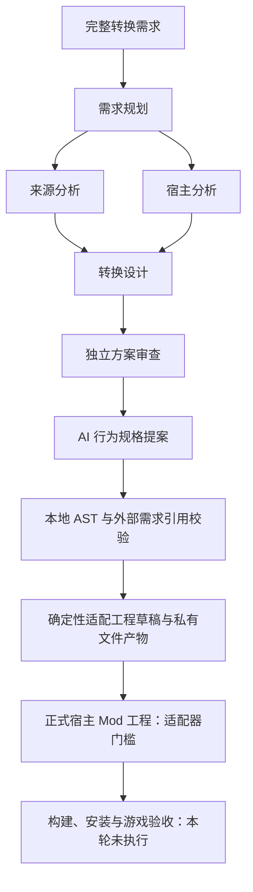

# 统一转换流程：0.9 Alpha

更新于 2026-11-05（Asia/Shanghai）。本轮把 AI 需求分析、受限行为规格及适配工程草稿接进同一个持久化任务。流程只处理文字、结构化数据和项目自有生成器，不启动游戏，不读取游戏资产，不编译或安装 Mod。

## 用户入口

运行 `npm run dev`，在本地工作台选择默认的“统一转换流程”，填写 `hostGame`、`sourceGame`、版本与完整需求。正常路径预留六次模型调用；可以减少预算，任务在预算不足处停止，明确增加总预算后只继续未完成阶段。

五角色分析继续可单独选择，正常五次调用。旧任务仍沿原工作流、原依赖图和原累计预算恢复，不补跑规格或改写历史。

`gamebridge.conversion-project.v1` 与旧 `gamebridge.multi-agent-analysis.v1` 是不同工作流。新图保留五份直接上游，再追加 `specify-behavior`、`validate-behavior`、`generate-adapter-project`，随后进入已有正式 Mod 生成门槛。

## 各阶段交付

| 阶段 | 实际交付 | 完成所代表的范围 |
| --- | --- | --- |
| 五角色分析 | 完整需求、资源/接口缺口、设计和审查意见 | 待核验文字提案，无研究工具或游戏支持声明 |
| AI 行为规格 | `BehaviorSpec v1` AST、假设、限制 | 状态/整数/事件规则提案，不包含任意源码或宿主效果 |
| 本地规格检查 | 所有原需求 ID 的外部绑定、AST 校验、未表达项和指纹 | 结构有效；`semanticCompleteness=false` |
| 适配工程草稿 | 固定九文件、可信 C# 代码和宿主绑定义务 | 有实际源码的独立工程草稿，没有宿主 SDK 或已绑定游戏接口 |
| 正式 Mod 工程 | 本轮阻断 | 缺精确版本适配器、已核验环境和资源 |
| Mod 编译/修复、安装、游戏 | `not_run` | 不启动任何对应进程 |

任务最终可因正式宿主适配器缺失而为 `blocked`，前面的草稿仍可下载。界面明确显示“工程草稿已生成 · 等待宿主适配”，不把这项阻断当作草稿未生成，也不把草稿提升为可安装 Mod。

## 工程文件

固定文件名和内容模板由本地代码控制：

- `Behavior.g.cs`：由已校验 AST 确定性生成的状态机。
- `HostBridge.g.cs`：事件进入状态机并读取快照的通用接点；不订阅游戏事件或施加效果。
- `GameBridge.AdapterDraft.csproj`、`NuGet.Config`：独立 net8.0 库，禁用父目录配置导入、分析器、SourceLink 和外部包源，无游戏引用。
- `request.json`、`analysis.json`：完整原文、方向、版本与全部五份已接受分析。
- `behavior.spec.json`：完整受限规格，含 `unresolved`。
- `binding-requirements.json`：逐项需求的事件、状态、效果、资源、来源保真、验收义务、审查问题和阻断。
- `README.md`：草稿使用范围和尚未接入部分。

没有 SDK 时也可本地生成这个草稿，生成本身零模型调用、不执行源码。收费阶段只是结构化规格分析；需要真实环境的 Mod 生成和修复保持阻断，不以缺环境为由付费生成任意源码。

模型无法指定文件路径、命令、依赖或执行权限。角色、武器、动画、碰撞、伤害和世界约束不能由一个同名整数变量实现；不可表达项保留为 `unresolved`，所有需求同时保留宿主绑定义务。即使 `unresolved=[]`，也不证明语义完整。五角色中的审查发生在规格之前，不冒充对后续规格的独立语义验收。

## 服务、文件和恢复

`POST /api/runs` 新增可选 `workflow`。缺省保持旧分析流程兼容；界面明确提交新工作流。`GET /api/runs/:id/project` 仅下载该任务已成功保存的草稿 ZIP，不接受客户端的路径或 artifact handle。

快照只保存私有文件 handle 和元数据；下载时核对清单、SHA-256、大小、文件身份及凭据回显。源码、用户资源与 Key 不进入公开仓库。取消在 staging 同步、rename 前后及对象目录同步后的边界检查，取消时不返回 handle，并仅清理本次对象。

每次模型调用前持久化预算预留；无自动收费重试。恢复失败任务须明确 `allowReplay=true`、有预算且未超过尝试上限。完成阶段不重跑，重启不自动调用模型；新流程另绑定 Node 精确版本、平台及生成器版本。更换绑定时阻断继续，不使用新环境隐式重放。

公开 GitHub Pages 仍只展示界面与说明，不收 Key，不请求本机服务，不生成私人项目。项目文件始终通过本地受控服务生成和下载。

## 验证记录

本轮 Node 测试包含真实调度、持久化、HTTP 与私有文件操作，模型返回值明确模拟；不算真实 DeepSeek 或游戏证据。覆盖六次预算、五次后暂停恢复、不重跑完成阶段、外部需求绑定错误、取消晚结果、草稿损坏、同任务下载和执行接口不存在。

最终 `npm test` 为 **228/228、0 跳过**，构建通过。另一次 macOS OS 沙盒复核运行原有通用编排/Agent 范围 **50/50**，正控和六项凭据/文件/网络负控通过；该组不是新 HTTP 下载或全部新流程的 OS 验收，也不与 228 项相加。新增三项文件系统取消测试分别在 staging 同步后、真实 rename 后、对象目录同步后取消，均不返回 handle、无本次残留，既有对象保持完整。

真实 DeepSeek 初次五次请求：前四角色通过，独立审查因 `/issues/0/id` 缺失拒收，没有进入规格或工程阶段。提示词补齐审查问题的必填对象结构后，显式恢复原任务并将总调用预算从六提高到七；追加一次审查仍因根对象合同不符拒收，达到该节点两次尝试上限。实际共六次 HTTP 模型请求，原四份分析没有重跑，第七次预算未使用；两次尝试和诊断保留。后来再明确审查根字段，并让已知多余字段返回静态字段路径、未知字段名继续隐藏，没有继续收费验证。两次原始拒收 JSON 均未留存，第二次不能断言具体哪个额外字段造成失败。

因此，**统一流程的模拟闭环与真实文件/HTTP 验证通过；本轮真实 DeepSeek 尚未进入规格阶段，不声明从需求到工程的真实模型闭环通过。** 规格能力的真实供应商稳定性仍待后续单独验证，不能将模拟响应当作真实调用。编译与游戏调用始终为零。

本地完整记录位于被忽略的 `artifacts/pipeline-20261105/`。这些文件不随公开仓库发布；可公开的状态、失败与范围限制记录在本文。
