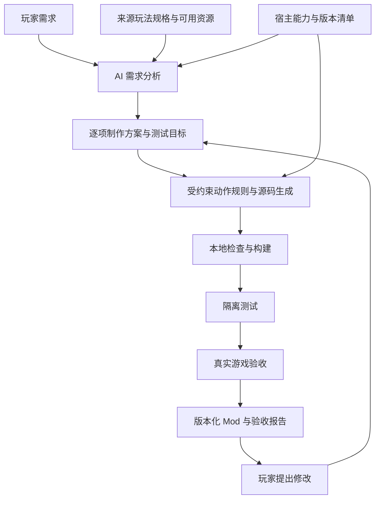

# GameBridge 产品目标与开发规划

规划日期：2026-10-30（Asia/Shanghai）。本文定义后续产品方向和交付门槛；当前代码为 0.5.0 Alpha，已增加动作规则基础，进展见 [工作台说明](ai-mod-workbench.md) 和 [动作验收记录](action-workbench-acceptance.md)。完整动作 Mod 首版仍为开发目标。

GameBridge 面向想改造单机游戏体验的玩家：玩家描述“在宿主游戏 A 中，使用来源游戏 B 的某组角色、武器或动作交互”，工具判断可行性，生成适配宿主的 Mod，并用真实游戏中的表现验证需求。核心交付是玩家可以操作、能影响宿主真实对象的玩法。源码、构建包和报告是实现这一交付的过程与证据。

## 1 目标用户和产品价值

首批用户是会安装 Mod、拥有测试游戏、能描述想玩什么，但不会编程的单机玩家。早期邀请少量 Mod 作者参与接口、动作效果和兼容性验证，由开发者维护适配器，逐步减少玩家需要处理的技术步骤。

| 用户 | 要完成的任务 | 产品价值 |
| --- | --- | --- |
| 首批玩家 | 把另一款游戏的一组动作带入熟悉的世界，并继续修改 | 用自然语言制作和调整可玩的 Mod，知道哪些需求真正实现 |
| Mod 作者 | 快速验证玩法组合、生成工程、定位错误 | 复用宿主接口和测试工具，减少重复搭建与调试 |
| 适配器维护者 | 增加宿主或来源玩法包 | 明确的能力规范、版本边界和实机验收方法 |

短期目标是完成一条真实可玩的链路，并证明用户换一种需求后仍能自动制作。中期目标是在同一宿主支持更多动作组合，再把同一来源玩法接到第二个宿主。长期目标是形成可验证的游戏组合目录，让支持范围随着适配器和规则包增长。

产品的核心指标是：**冻结范围内的新需求，有多少能在不人工改源码的情况下，得到通过真实游戏验收的 Mod。** 不能只用模型返回率、编译通过率或已填入的游戏名称数量衡量进展。

## 2 转化的对象和交付方式

A 始终是宿主，B 始终是玩法来源；代码使用 `hostGame` 和 `sourceGame`。宿主提供实际运行的世界、敌人、物理、存档和基础操作；来源提供玩家希望体验的具体规则与可用资源。

转化需要分别处理三部分：

| 部分 | 需要描述和验证的内容 | 完成条件 |
| --- | --- | --- |
| 玩法规则 | 输入、动作状态、起手与后摇、命中窗口、资源消耗、取消和中断条件 | 在宿主中产生对应行为，并通过逐项测试 |
| 内容资源 | 角色、武器、骨骼、动画、音效及其使用来源 | 所需资源可用，完成宿主导入与对齐；替代资源明确标识 |
| 世界交互 | 动作对宿主敌人、碰撞、伤害、菜单、死亡和存档的影响 | 与宿主真实对象交互，退出后按预定方式恢复 |

首版采用宿主原生 Mod 路线：把选定规则重新实现为宿主能加载的模块，通常只需运行宿主游戏。来源游戏不是默认需要同时运行的第二个进程，也不是只填一个名称就能自动读取出的完整规格。来源规则由有出处的玩法说明、作者制作的动作规格、可使用的资源，以及玩家确认的目标共同定义。双游戏运行时桥接不作为当前主线。

玩家可以要求只迁移机制，也可以要求机制与外观同时迁移。若要求完整角色和招式，缺少角色或动画资源就属于未完成；不能使用宿主默认模型后宣布角色移植成功。动作在另一种物理或视角下需要近似时，要说明具体损失，让玩家决定是否接受；原始要求始终保留。

## 3 首个产品版本的范围

建议首先验证三维近战动作体验，覆盖一个宿主的精确版本、一款来源游戏中的一个明确武器动作片段，以及一个可重复测试的单人场景。这样能直接检验角色、武器和动作交互的核心价值。枪械与射击规则作为后续玩法类别，GTA 中体验 CS 仍是产品方向示例。

首个动作片段的目标是：一个可操作角色、一把武器、可见且时序对应的攻击动作、连击或蓄力、闪避或取消、资源限制，以及受击或死亡中断。最终采用哪些来源招式，须在宿主能力探针和来源规格核对后冻结；不能为绕过失败临时删除核心动作。

首版可以复用宿主玩家角色，重点验证来源动作和武器交互；新角色外观与骨骼按单独的资源能力推进。玩家若明确要求来源角色的外观，则该项继续计为必需需求，不能因首版范围而自动删除。

一个首版需求示例是：“保留宿主世界与敌人，加入指定来源武器的三段轻击和闪避取消，攻击消耗体力，受击后打断连段。”它需要通过真实命中、资源消耗和状态转换测试。单纯调整速度或伤害倍率不能满足该需求。

首版范围分为两个关口：

1. **玩法可行性**：开发者先用最小探针证明宿主允许加载、输入、动作切换、命中和恢复。这只是开发基线。
2. **自动化可重复性**：工具从不同自然语言需求生成不同动作行为，并在修改需求后重新生成、构建和验收。达到这一步才交付 AI 制作工具首版。

## 4 宿主选择和环境要求

宿主必须同时具备获允许的 Mod 路径、可追溯接口、动作与战斗能力，以及实际可使用的测试环境。现有 SMAPI 代码可继续验证模型调用和构建流程，但两种 Buff 的结果不足以决定动作类产品首发宿主。

| 候选 | 官方资料能够确认的基础 | 本规划中的取舍 |
| --- | --- | --- |
| Mount & Blade II Bannerlord | 官方模块、资源、动画工具和版本化 API；工具与游戏需要同版本、安装在同一硬盘 | 优先进行三维近战能力探针；动画导入能力本身不证明连招和取消控制可行 |
| Skyrim Special Edition | 官方 Creation Kit 支持角色、武器等内容制作，要求对应 PC 游戏与 Windows 环境 | 保留为角色和装备方向的候选；精确动作控制仍需单独证明 |
| Teardown | 官方 Lua、工具、动画与物理查询接口 | 可研究射击和工具交互；体素表现与当前动作目标的契合度较低，不作为默认主线 |

Bannerlord 的三维近战路线值得评估，其首轮环境按 Windows 准备。用户当前没有 Windows，实机选型先核查 macOS 可用宿主；游戏组合尚未冻结，任何新宿主均未验收。需要先具备合法可用的游戏和工具、确认精确版本，再完成同一组准入探针：

- 模块加载并退出，版本与依赖可识别。
- 输入能够驱动必要动作，不破坏菜单和原生控制。
- 动画、动作状态与命中时机可以保持一致。
- 命中作用于真实敌人，反馈、消耗和中断可观测。
- 退出、死亡、换场景和卸载能按预期恢复。

核心能力缺失时停止该路线，记录原因并比较下一个候选；不通过进程注入、内存修改或反作弊规避补齐接口。具体宿主和来源规则包在这一关结束时共同冻结。用户当前没有游戏环境，因此现阶段不能承诺完成日期或宣称已选组合可玩。

来源规格至少冻结：来源游戏与版本、具体武器和招式、参考出处、动作顺序与时序、命中与取消条件、允许近似及误差，以及资源出处。仅有“三段攻击加闪避”的通用描述，不足以证明迁入了某款来源游戏的特征。

tModLoader 进入 macOS 资料评估，尚未进入支持目录或冻结为首发组合。其二维表现与原定三维动作方向的差异需要明确，不能默认为玩家接受。候选变化不改变真实动作与自动制作的验收标准。[环境与候选说明](host-environment.md)

依据：[Bannerlord 官方 Mod 文档](https://moddocs.bannerlord.com/)、[工具安装要求](https://moddocs.bannerlord.com/asset-management/faq/)、[动画导入要求](https://moddocs.bannerlord.com/asset-management/asset-types/animations/)、[版本化 API](https://apidoc.bannerlord.com/)；[Creation Kit 官方说明](https://store.steampowered.com/app/1946180/Skyrim_Special_Edition_Creation_Kit/)；[Teardown 官方 Mod 文档](https://teardowngame.com/modding/)和 [API](https://teardowngame.com/modding/api.html)。以上为候选资料，取舍是产品规划判断，不构成支持声明。

## 5 玩家使用流程

1. **描述体验**：选择宿主和玩法来源，写明想保留的宿主内容，以及希望带入的角色、武器和动作。界面提供动作示例帮助表达，不要求玩家懂 API。
2. **检查可行性**：本地检查版本、适配器、工具和资源；模型拆解需求。每一项显示可制作、需要资源、需要适配或无法实现。缺完整构建环境时不启动收费代码生成；用户仍可选择明确标注的规划或源码草稿模式。
3. **核对制作方案**：展示动作说明、输入、资源依赖、近似点、预期测试和调用预算。歧义通过少量问题解决；关键动作无法实现时阻断完整制作，不能偷偷替换。
4. **自动制作**：调用模型生成受约束的规则和允许修改的源码，本地生成固定工程，检查、构建并执行适用的隔离测试。失败时指出是模型输出、源码、环境还是玩法映射问题。
5. **真实游戏验收**：在独立测试配置中加载 Mod，检查角色操作、命中反馈、状态恢复与需求覆盖。初期可以由测试者执行步骤，工具收集本地诊断；后续再为宿主补充可重复的自动回放。
6. **继续修改与交付**：玩家说“允许第二段后闪避”“重击改为蓄力”，工具展示变化、重新生成和测试。通过后交付版本化 Mod、安装说明及验证记录，后续提供安装清单和回滚能力。

第 5、6 步的安装、执行与回滚属于待开发能力；当前主工作台仍不安装或执行生成 DLL。未来落地前需要为具体宿主定义独立测试环境、文件变更清单和恢复测试，不能将本规划直接当作执行授权或现有能力。

## 6 系统结构

复用的核心是“来源玩法规格＋宿主能力＋动作规则”，再由各宿主适配器处理不同接口。

| 层 | 职责 | 需要维护的内容 |
| --- | --- | --- |
| 需求层 | 保留原始请求，拆解功能，处理歧义和缺口 | 每项需求与生成内容、测试结果的对应关系 |
| 来源玩法规格 | 定义玩家想迁入的动作和资源 | 输入、时序、状态、判定规则、资源来源与保真目标 |
| 动作规则层 | 描述可组合行为，不直接绑定某款游戏 API | 起手、命中、后摇、连段、取消、消耗和受击转换 |
| 宿主适配器 | 把动作规则落实到宿主世界 | 版本、允许接口、动画绑定、实体与伤害、生命周期、构建和测试 |
| AI 制作层 | 根据能力生成规则、有限源码和修改方案 | 模型适配、结构校验、预算、诊断与有限修复 |
| 本地执行层 | 管理工程、编译、测试、产物与恢复 | 固定依赖、隔离边界、任务状态、版本记录和安装清单 |

动作规则需要支持真实行为差异。例如“只有命中后才能接第二段”和“挥空也能接第二段”是不同状态转换；修改伤害倍率则只是参数变化。来源玩法规格可以复用到第二个宿主，但物理、相机、骨骼和接口差异必须重新映射、测试。

首版先从少量有测试的动作操作构建规则层，不提前建设覆盖所有游戏的庞大统一引擎。现有纯计划与生成核心继续保持浏览器、Node 通用；网络、打包和本地执行放在 Node。新增运行依赖须有具体宿主需要。

## 7 AI 能做什么以及本地必须控制什么

模型负责需求理解、动作组合、允许范围内的源码生成，以及依据诊断提出修改。适配器提供经过核对的版本文档和能力，模型无权自行宣布宿主支持某接口或某项需求已经验收。

本地固定工程、依赖、文件路径、构建命令、工具权限和资源上限。当前仍只允许模型修改 `ModEntry.cs`；未来若引入动作文件或更多模块，需先实现明确的文件与操作白名单、独立验证和隔离测试，再扩大生成范围。不能先让模型自由运行命令来弥补适配器不足。

分析、生成、修复和游戏测试分别记录。完整构建先查真实环境；现有代码修复继续最多两次，只有可修复的 C# 源码错误才能触发。模型格式失败不使用模板冒充成功，认证、缺引用或重复错误不继续消耗修复次数。游戏行为不符需要专门的动作诊断，不能无上限地套用编译修复循环。

玩家能看到已用调用数、剩余上限和停止原因。金额估算应在取得供应商价格及实际用量后提供；当前调用次数不冒充真实账单。API Key 留在本机，不进入日志、源码包或编译环境；游戏文件、资产和存档保持本地，云端只接收明确的需求、允许源码与脱敏诊断。资源导入仅处理用户提供或可使用的材料，不自动提取、上传或分发商业游戏资产。

## 8 首版验收标准

首版必须同时证明玩法成立和自动化成立。每项核心需求都有可观察的测试，不能只看日志或截图里是否出现武器。

| 验收对象 | 需要的证据 |
| --- | --- |
| 需求覆盖 | 原始需求保留；所有必需项对应实现和测试；近似、缺失与资源替代明确 |
| 来源特征 | 已冻结来源动作规格与比较标准；招式顺序、时序、取消和资源规则逐项核对 |
| 构建 | 针对真实宿主和 Mod 环境的引用或工具构建，记录精确版本和产物 |
| 游戏交互 | 实际加载、输入、可见动作、真实目标命中、受击及死亡反馈 |
| 恢复 | 菜单、场景切换、重载后状态正确；退出游戏后按清单卸载，原有配置与测试存档符合恢复预期；热卸载需另行定义与验证 |
| 自动化 | 至少三种自然语言需求产生不同的动作逻辑，而非只换参数；再完成一次需求修改与回归，期间不由开发者逐例修改计划、动作规则、资源绑定或源码 |
| 可复现性 | 锁定环境、动作包、模型输出、工程和步骤，第二次运行结果可解释 |

内测前预先冻结 10 个范围内的新需求，作为首轮评估集。建议门槛为至少 8 个无需开发者逐例修改制作产物即可通过全部必需项的实机测试；这个数值是开发目标，当前成绩未测。制作产物包括计划、动作规则、资源绑定和源码。用户允许的澄清、安装步骤，以及评估前制作的通用适配器和来源玩法包，均须提前列明，不能针对失败案例手工修正后计为自动成功。

每例提前锁定分析、生成、修复的调用和时间上限，以及从首次请求到验收的总时间上限。首轮可沿用当前的一次分析、一次生成与最多两次源码修复预算，游戏验收用时和总时限在选定宿主后冻结。所有尝试和失败都计入结果；超限后的重跑属于同一案例的追加尝试，不回写首次成绩。旧计划回放和人工改好的产物不能算作全新成功。

同时记录收到的全部需求、被判定超出范围的需求及原因，防止通过不断缩小支持范围抬高成功率。除成功率外，记录实际制作时间、调用数、需人工处理的步骤，以及玩家认为与来源玩法不符的项目。构建、隔离测试和游戏验收各有状态，不能相互代替。

## 9 开发阶段和停止条件

按可验证成果排期。真实游戏环境是动作适配阶段的前置条件，取得环境并完成能力探针后才能给出可靠的工期估算。

| 阶段 | 交付 | 进入下一阶段的条件 |
| --- | --- | --- |
| 产品范围 | 本规划、目标用户、动作切片与选型标准 | 不再把固定 Buff 或源码下载作为最终体验 |
| 宿主与来源准入 | 正版测试环境、精确版本、官方接口依据、最小动作探针、来源动作规格 | 核心输入、动作、命中、反馈和恢复在真实宿主可行；否则停止该候选 |
| 动作适配基础 | 小型动作规则、宿主映射、资源绑定、可重复测试基线 | 完整动作片段真实可玩；手写基线仅作为开发参照 |
| AI 制作闭环 | 结构可靠的分析、受约束生成、真实构建、有限修复和需求追踪 | 三种不同动作需求及一次修改无需人工改源码，均通过实机验收 |
| 玩家内测 | 首轮需求评估、制作与安装引导、版本与恢复记录 | 达到冻结的需求验收门槛，阻断性故障完成处理 |
| 复用验证 | 第二个来源动作包，再接第二个宿主 | 用实际变更证明规则和工具链可复用；每个新组合单独验收 |

出现无法获允许接入、核心动作缺接口、资源无法取得、真实验收反复失败等情况时，保留失败和缺口，调整候选或明确缩减后的独立提案。不能维持原名称却把核心要求替换成简单 Buff。

## 10 现有代码的处理

保留 DeepSeek 连接、计划校验、任务状态、构建调度、调用预算、源码包与沙盒测试工具。0.5.0 已加入有界动作规则、回放和宿主门控基础，首页采用动作制作入口，尚无动作宿主适配器。继续评估分析的结构与语义可靠性，保留独立记录；上次分析失败不能由旧计划生成成功覆盖。

现有星露谷加速和近战倍率继续标注为管线测试能力，不再作为首个动作产品的完成标准。不继续增加未经验证的游戏名称，不把页面发布或模拟器通过计为游戏接入。当前沙盒结果仍是 21 个契约场景、75 条断言通过；真实 Mod 编译和游戏运行均未验收，角色、武器与完整招式尚未实现。

首版交付形态以本地工作台配合本地执行程序为主，模型供应商可替换，玩家使用自己的 API 凭据。公开网页用于说明、下载和展示可追溯的支持目录。GitHub 持续同步项目与验证结果；网页更新、工具版本更新和生成 Mod 更新分别管理。社区配方共享可以后续加入，只分享可分发的规则与工程，不夹带用户资产、存档或凭据。

