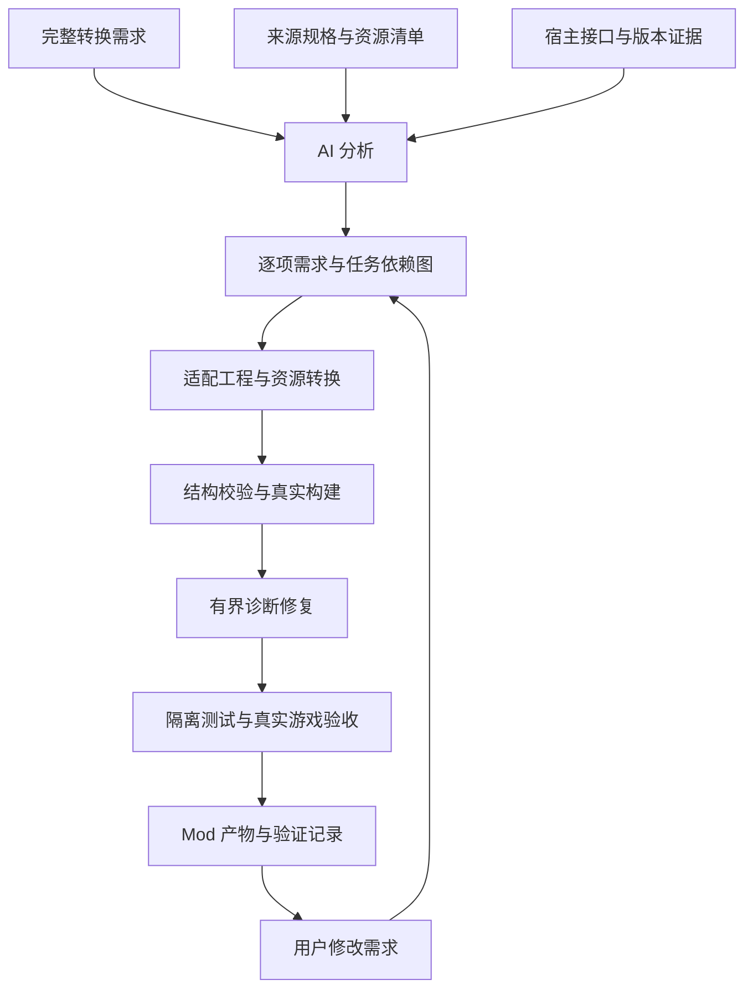

# GameBridge 转换器产品规划

更新于 2026-11-04（Asia/Shanghai）。GameBridge 面向希望改造真实游戏的玩家和 Mod 作者：用户指定宿主、内容来源及期望体验，工具调用可替换模型，分析可行性、编排转换任务，生成可构建的适配工程，并以真实游戏表现验收。

长期目标是扩大可验证的游戏覆盖范围。当前 0.8.0 Alpha 已有分析编排底座，以及规格到独立 C# 行为库的真实编译/验证内核；自然语言到规格的桥接、资源和宿主后端尚未接入。游戏适配器仍为空，尚无可安装 Mod 或已验收转换组合。[当前实现](ai-mod-workbench.md) · [执行内核](execution-kernel.md)

## 转换对象与方向

代码和界面始终使用 `hostGame` 与 `sourceGame`。宿主是用户实际游玩的游戏，提供世界、实体、物理、输入、存档与扩展接口；来源提供用户希望迁入的角色、武器、招式、玩法规则或可使用资源。游戏名称本身不能代替版本、资源和玩法规格。

| 转换对象 | 必须分析的内容 | 最终验收依据 |
| --- | --- | --- |
| 角色与武器 | 模型、骨骼、材质、动画、装备接口及资源使用范围 | 在宿主中正确显示、操控并影响真实对象 |
| 招式与交互 | 输入、时序、状态、碰撞、命中、资源、取消和中断 | 行为与约定规格相符，覆盖正常与异常路径 |
| 玩法规则 | 规则事件、实体关系、胜负条件、进度和存档 | 宿主真实事件驱动规则，状态可恢复 |
| 其他资源与系统 | 地图、音效、UI、数据和接口差异 | 对应资源可用、导入有效，损失和替代明确 |

转换方案必须保留全部原始要求。所需资源或宿主接口缺失时，列出缺口并阻断依赖任务；不能把角色和招式要求缩减为速度、伤害或固定枪械参数后宣布完成。用户允许的近似与替代需要作为明确约束记录。

## 用户流程

1. 选择宿主与来源，填写内容类型、准确版本及完整需求。
2. AI 拆解逐项需求，列出来源规格、资源、宿主接口和待澄清问题。
3. 本地能力注册表核对证据，形成具有依赖关系、输入输出及完成条件的任务图。
4. 适配器准备就绪后，在明确文件与操作范围内生成工程、转换资源及实现交互。
5. 执行结构校验、真实构建与有限诊断修复，再在独立配置中进行真实游戏验收。
6. 交付 Mod、安装与恢复清单、来源和特征损失报告；用户修改需求后追踪影响并重新验证。

当前已实际运行分析协作任务，并具备持久化、预算和恢复机制；游戏转换仍停留在第 3 步的分析与规划范围。研究角色没有检索或文件工具，不检查安装、不读取游戏资源；其任务完成仅表示未核实提案通过结构校验。第 4–6 步需要真实游戏适配器，继续保持阻断。

## 通用系统结构

| 组件 | 通用职责 | 游戏相关部分 |
| --- | --- | --- |
| 需求与证据合同 | 保留原文、逐项要求、未知项、来源、版本和阶段状态 | 具体内容与接受标准 |
| 模型连接层 | 供应商配置、结构化输出、调用上限、取消与凭据隔离 | 适配任务提供的受约束上下文 |
| 任务编排器 | 依赖关系、输入输出、阻断、重试规则、变化追踪 | 每个任务要求的宿主或来源能力 |
| 来源与资源适配器 | 分析内容格式、许可范围、规格和可用资源 | 提取、导入、骨骼与数据转换规则 |
| 宿主适配器 | 提供版本化接口、工程协议、能力边界和验收方法 | 原生 Mod 接口、实体与行为绑定 |
| 本地执行器 | 文件边界、工具调用、诊断、构建、测试和产物管理 | 经核验的工具链与运行环境 |

工具主干不能绑定某一款游戏、某种语言、某个入口文件或一组固定玩法模板。适配器可以使用经过验证的工程骨架，但用户的内容需求、任务图和实现范围不能退化成只为该骨架填写参数。新增游戏应复用同一合同与编排机制，并为差异增加独立适配能力。

## 支持范围如何增长

覆盖范围按“来源版本 × 宿主版本 × 内容类型 × 运行环境”记录。能够分析游戏名称，只表示该名称进入需求；能够读取资源，不表示能够作为宿主；编译通过也不表示玩法成立。

适配器协议、版本化能力解析和通用分析执行边界已落地；下一步接入有证据的通用工具，再用真实游戏案例验证。游戏选型服务于可复用机制的验收，不成为独立产品。扩展时优先复用引擎、格式与接口共性，同时核对游戏差异。未知接口、未核验版本和不可用资源继续保持阻断，AI 无权提升支持状态。

新增适配器至少包含：

- 接口或格式的可追溯出处、适用版本和平台。
- 能力清单、允许的文件与操作、构建和运行前置条件。
- 资源来源、使用范围、导入规则与特征损失。
- 畸形输入、消息与资源上限，以及取消和失败恢复测试。
- 真实编译、游戏加载、交互和清理状态的独立证据。

## 阶段与完成门槛

| 阶段 | 交付 | 完成条件 |
| --- | --- | --- |
| 转换器底座 | 通用需求合同、AI 分析、缺口和任务图 | 不依赖固定游戏；保留全部请求；未知能力不会变成已实现 |
| 适配协议 | 来源、资源、宿主与工具能力注册规范 | 同一任务图可选择不同实现，版本与权限可核对 |
| 工程与执行 | 受约束工程生成、本地校验、构建和有限修复 | 使用真实依赖，环境失败与源码错误分类，产物可追溯 |
| 真实转换验收 | 逐项游戏交互、资源表现和恢复测试 | 新需求与修改无需逐例手工改产物即可完成约定范围 |
| 跨游戏复用 | 新来源、宿主与内容类别 | 用实际变更证明通用底座可复用，每个组合单独验收 |

评估同时记录收到的全部需求、被阻断需求及原因、每次模型尝试、人工干预和特征损失。格式通过率、源码下载、模拟测试和网页发布均不能替代真实转换成功率。首个宿主通过一次案例，也不能代表工具已覆盖多数游戏。

## 数据与执行边界

API Key 仅在本地请求使用，默认凭据绑定配置的 API origin；不进入浏览器存储、日志、下载包、Git 或构建子进程。当前云端分析仅接收文字需求和合同，不上传游戏文件、资产或存档。

未来工程生成必须先定义适配器的允许文件、依赖、构建参数和执行边界。代码文本检查不是沙箱；生成、编译、安装和游戏运行分阶段执行，分别记录边界与证据。缺少真实环境时阻断相应执行任务，不发起收费代码生成。修复上限与允许触发的诊断类型由本地任务策略控制，认证、基础设施和缺资源问题不能反复消耗模型调用。

采用官方或获允许的 Mod、插件、导入与编辑接口，不实现进程注入、内存修改或反作弊规避，不承诺零封禁。用户已有文件、凭据和存档保留在本地；公开仓库只提交工具代码、可分发规范和经过核对的验证记录。
