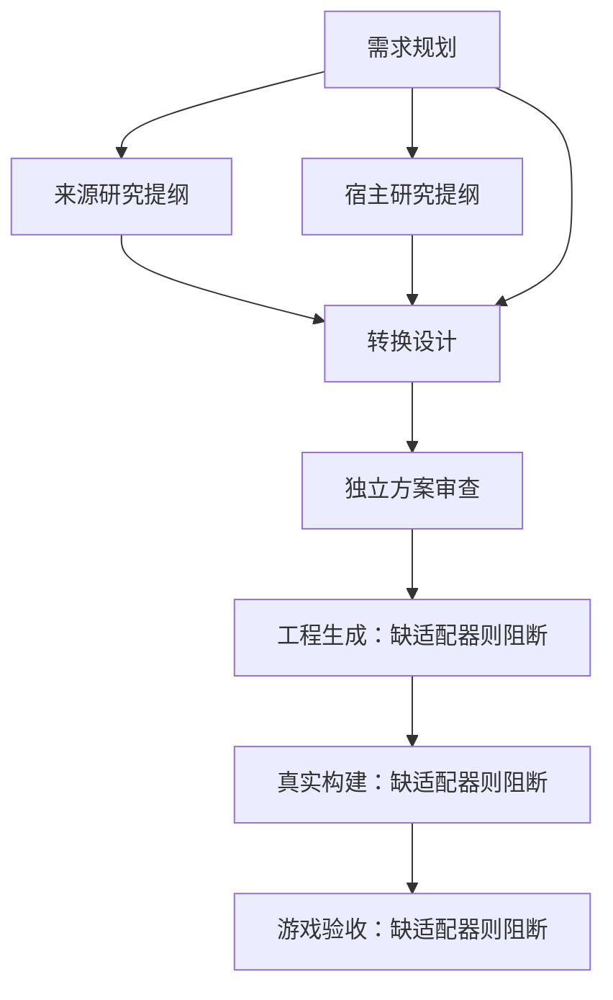

# 通用任务、适配器与可恢复运行

0.9 新增 [分析、规格与工程草稿统一流程](conversion-pipeline.md)，使用独立工作流 ID 与六次正常调用预算；本页的通用合同和旧五调用任务仍可读取，恢复时不重写历史图。

更新于 2026-11-04（Asia/Shanghai）。默认工作台有五类分析角色；独立行为执行入口登记通用规格、生成、编译和验证工具，没有经过准入的游戏、资源转换、Mod 工程或游戏验收适配器。[执行入口与证据范围](execution-kernel.md)

多角色可以真正分任务运行、保留结果并从中断处恢复；当前研究角色仍只产生待核验的研究提纲，没有浏览器、游戏文件或资源检查工具。任务完成、格式校验、接口证据、真实 Mod 编译和游戏验收保持不同含义。

## 任务协议

`src/orchestration/protocol.mjs` 提供 `validateTaskDefinition` 和 `validateTaskGraph`。任务定义是有界 JSON 数据，不接受函数、命令、路径、凭据、执行状态或权限声明。

| 字段 | 含义与边界 |
| --- | --- |
| `schemaVersion` / `id` | 协议版本 1 与图内唯一标识符 |
| `kind` / `role` | 已知任务种类和五类逻辑角色之一 |
| `dependsOn` | 显式前置任务；拒绝不存在、自依赖与循环依赖 |
| `requirementIds` | 需求标识引用；分析前未知的动态需求可暂空，原文仍在运行上下文保留 |
| `inputRefs` | `input:request`、`task:requirements` 等逻辑输入引用，不是文件路径；`task:` 引用必须出现在显式依赖中 |
| `outputTypes` | 至少一个明确的产物类型；不能依赖未标明类型的默认产物 |
| `requiredCapabilities` | 所需能力名称，由本地注册表解析；写出名称不等于能力存在 |
| `acceptanceCriteria` | 至少一项接受条件。文字条件不是执行或语义正确性的证明 |
| `retryPolicy` | `maxAttempts`、`retryableCodes`、`replaySafe`；协议最多三次尝试，实际图和总预算可以更严格 |
| `timeoutMs` | 有界观察时间，受适配器自身上限进一步约束 |

一张图最多 64 个任务，定义有字段、文本、节点、深度与字节预算。模型不能把 `status=succeeded` 写进任务定义，也不能把调用成本声明为零。任务状态、预算与产物来源由本地调度器记录。

当前内置图是受控的协作流程，不是可自行扩权的动态规划器：

后续根据调查证据与诊断改变任务图，需要新增经过校验的重规划协议；当前不会把模型描述的任务直接变成任意工具调用。

## 适配器注册合同

`src/adapters/registry.mjs` 提供 `validateAdapterManifest` 与 `createAdapterRegistry`。登记方式是本地代码调用 `register(manifest, handlers)`，每个允许操作必须绑定一个实际函数。模型返回一份 manifest、脚本字符串或工具名称，均不能创建执行能力。

Manifest 包含：

- `id`、精确 `version`、`kind`、`role`，以及 `targets` 与 `contentKinds`。
- `capabilities`：能力 ID、操作名和允许产物类型；`allowedOperations` 只列明本地操作。
- `execution`：本地声明的副作用类别、幂等性和每次尝试需要预留的模型调用数。
- `evidenceScope`、可追溯 `references`、`limitations` 与输入、输出、时间上限。

分析适配器的 `kind=agent`，能力位于 `agent.*`；它的 `targets` 必须为空，不代表支持任何实际游戏。`analysis-only` 只能声明 `analysis.*` 类型产物，契约测试范围只能声明 `test.*` 类型产物。即使任务写成规划类型，分析适配器也不能输出 `mod.build` 或 `game.acceptance`。

游戏相关适配器必须声明精确游戏版本、平台、来源/宿主方向、内容类型与接口依据。未知版本、平台不匹配、内容不匹配、能力缺失或多个实现选择不明确，都保持阻断。注册表返回 manifest 的副本，函数绑定不进入公开清单。五个分析角色不能被统计为五个已支持游戏。

注册合同是调度与权限边界的一部分，不是操作系统沙箱。当前没有公开的任意命令或模型代码执行接口。

## 持久化、预算与恢复

0.8 新增 `kind=tool`：无游戏 targets/contentKinds，以精确工具链和格式匹配；能力/输出必须是 `tool.*`，范围仅 `tool-execution` 或契约测试，不匹配游戏验收任务。游戏兼容合同保持独立。新分析运行写入本机平台，新生成节点拿完整五份上游，旧运行图保持原状。

`src/orchestration/store.mjs` 在本机保存运行快照；默认存储根为项目的 `.gamebridge/`，快照位于其 `runs/`，写入租约位于 `locks/`。该目录被 Git 忽略。可编程使用 `createRunStore({ root })` 指定另一个绝对目录。

快照保存原始需求、任务定义、尝试记录、调用预留、接受的结构化结果、产物哈希与来源，以及事件序列。数据和凭据检查在持久化之前执行；API Key、认证字段和已知凭据回显不得保存。恢复执行时重新提供凭据，运行记录只绑定原模型地址和型号。

存储采用临时文件、同步与原子替换，并以 revision 防止陈旧写入覆盖。每个运行只有一个写入租约；活进程持有租约时其他写入者会收到忙碌状态。进程退出后可以恢复遗留租约。校验和用于发现数据损坏，不是发布者签名，也不能替代操作系统隔离。

调度器在调用 handler 前，先持久化一次尝试和模型调用预算预留。来源与宿主任务可以并行；依赖未完成、缺适配器或预算不足时不会偷偷继续。默认分析流程预算为五次模型调用，预算表示整次运行总量，恢复不会重新获得一份免费额度。预留是保守上限，不等同于供应商最终账单；失败或取消也不假定调用没有发生。

恢复遵循以下规则：

普通 `run` 只启动新建运行；已经阻断、失败、中断或取消的运行必须走显式 `resume`，不会因晚到的初次调度而重新开始收费工作。

1. 已完成并提交的任务不重放，后续任务使用已接受的上游结果。
2. 上次进程停止时仍在运行的尝试记为 `interrupted`，不能推断请求是否已计费或工作是否完成。
3. 自动重放只有在任务允许、本地操作声明无副作用且幂等、没有模型费用并仍有尝试预算时才可能发生；失败还须匹配允许重试的错误类别。
4. 模型任务失败、中断或取消后，需要显式 `allowReplay` 和剩余总预算才能再次调用；当前五个分析角色不自动收费重试。
5. 取消或超时停止后续调度，并丢弃晚到结果。迟到的旧尝试不能覆盖已经恢复的新尝试。

任务的 `succeeded` 只表示该操作返回的数据经过本地合同校验并持久化。调度器生成产物类型、哈希、大小及适配器版本/操作/任务/尝试来源，不接受模型自行写这些证据。当前运行报告始终保持 `realModBuild=not_run`、`game=not_run`、`readyToInstall=false`。

失败只保存错误码、固定消息与经过本地白名单重建的合同诊断。诊断可指出 `/coverage` 等已知路径和校验规则，不保留拒收输出、未知属性名或外部异常文本。本轮测试与真实模型部分失败记录见 [编排验证记录](orchestration-verification.md)。

## 当前多 Agent 的实际范围

| 角色 | 当前任务 |
| --- | --- |
| 需求规划 | 一次结构化请求，保留完整需求与资源、接口缺口 |
| 来源研究 | 根据需求提出来源行为与资源的待调查项，不声称已查询资料 |
| 宿主研究 | 根据需求提出正式接口和环境待调查项，不声称已检查安装 |
| 转换实现 | 使用上游报告编写转换设计，当前不生成源码或执行命令 |
| 独立验收 | 对照逐项需求审查设计覆盖、缺项与未证实结论，当前不运行游戏 |

每个角色是独立上下文和一次独立模型请求；可以共用同一供应商和型号。上游报告作为未验证数据传递，不是给下游的系统指令。独立审查的“已在方案中涉及”只描述文稿覆盖，不等于实现成功。

工作台可启动协作、查看本机历史、取消、检查恢复及导出运行记录。公开 GitHub Pages 不读取这些本机状态，也不收集凭据。完整接口与用户入口见 [使用与实现状态](ai-mod-workbench.md)。

当前完成的是可复用任务协议、注册边界、持久化调度和分析角色协作；游戏接口调查工具、资源转换、工程生成、真实构建与游戏验收仍需后续适配器和证据，不能据此宣布已支持通用游戏转化。
